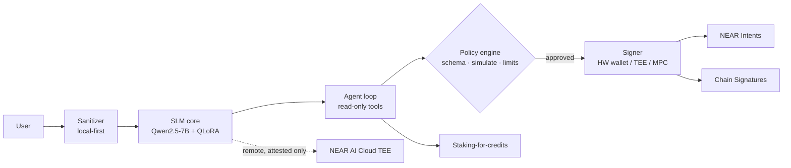

# Architecture — NEAR Privacy AI

## Diagram

> Fail-closed at every arrow: no attestation → no remote call; no policy pass → no signature.

## Layers
1. **SLM core** — Qwen2.5-7B-Instruct + QLoRA adapter specialized in crypto analysis, privacy tooling, cypherpunk concepts, on-chain reasoning. Runs locally by default (privacy-first).
2. **Agent layer (Phase 2)** — tool-calling loop (TypeScript/Python) with read-only data tools first (RPC queries, explorer/indexer lookups). Write actions go through a policy engine, never directly from model output.
3. **NEAR integration (Phase 3)**
   - **NEAR AI Cloud private inference** — TEE-backed (Intel TDX / NVIDIA confidential computing) OpenAI-compatible endpoint, with attestation that can be checked. Used when local hardware is not enough.
   - **Agent Market** — list agents, accept jobs, escrow/payment flows via the official SDK.
   - **NEAR Intents** — outcome-based/cross-chain execution: the agent states the *desired outcome*, solvers fill it.
   - **Chain Signatures** — MPC-signed transactions on other chains from a NEAR account. Requests get signed only after policy checks.
   - **Staking-for-credits** — Rust/near-sdk contract: stake → inference credits, metered usage.
4. **Privacy hardening (Phase 4)** — local prompt sanitization/rewriting, TEE paths, unlinkable payments, minimal logging.

## Privacy principles
Local first. Send data out as little as possible. Do not keep prompt logs by default. Check attestation before sending to remote inference. Strip PII and addresses before any remote call when the user wants that.

## Security & key management (RISKS FLAGGED)
- **The model never holds raw private keys.** Keys stay in a separate signer: a hardware wallet, a TEE enclave, or a Chain Signatures MPC request path.
- Every transaction the model proposes goes: proposal → schema validation → simulation → policy engine (allowlists, per-tx and daily spend limits, rate limits) → human or threshold approval above limits → signer.
- Prompt injection through on-chain data (memos, token names, contract metadata) is a known threat. Treat it as untrusted input.
- Use function-call access keys with tight allowances on NEAR instead of full-access keys.
- Compliance: privacy tools (mixers, shielded pools) have jurisdiction-dependent legal status. The model teaches concepts and must not help launder funds.

## Assumptions (to verify against official docs before Phase 2/3 code)
- A1: NEAR AI Cloud exposes an OpenAI-compatible API with TEE attestation endpoints (per docs.near.ai). The exact routes are not encoded yet.
- A2: The Agent Market SDK package name, API and escrow semantics are not checked yet. Phase 3 must read the official repo first.
- A3: The Intents contract (`intents.near`) and solver relay API are to be confirmed in docs.near.org/chain-abstraction/intents.
- A4: Chain Signatures MPC contract IDs (mainnet/testnet) and the `sign` request format are to be confirmed in docs.near.org/chain-abstraction/chain-signatures.
- A5: Staking-for-credits is our own contract design, not a NEAR primitive.
- A6: "IronClaw" concepts are referenced in the brief. Look up the details before using them.

## Phases
1. SLM foundation (data, QLoRA, eval, local inference) — **in progress**
1.5. Privacy merge gate — **OPEN** (item 5 refusal eval SIGNED OFF: 7B Colab 8/8, Privacy Security)
2. Agent tools + private inference
3. Contracts, Intents, Chain Signatures, Agent Market, credits
4. Privacy hardening, policy engine, production docs
