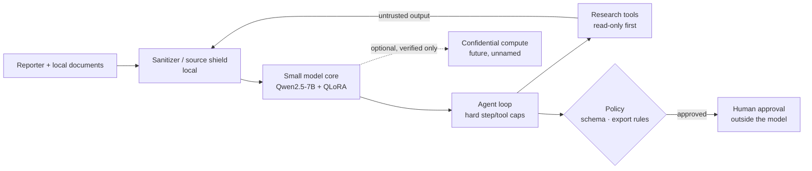

# Architecture — Salomon (local research agent for journalists that protects sources)

> Niche locked 2026-10-29 (`docs/notes/PRODUCT_NICHE.md`). Prior crypto/on-chain integration is parked — see the end of this file and `docs/archive/crypto/`.

## Diagram

> Fail-closed at every arrow: no verification → no remote call; no policy pass → no save/export/share; source identifier or secret detected → mask, refuse, don't echo.

## Layers
1. **Small model core** — Qwen2.5-7B-Instruct + QLoRA (Qwen2.5-0.5B for CPU smoke). Gated to refuse secret/identifier echo, crime assist and prompt injection (refusal eval R1/R2/R3, CI exit 1 on any fail). Runs locally on the reporter's machine by default.
2. **Sanitizer / source shield** — strips PII, contacts and secrets on input and before any remote call; wraps `role:tool` output (documents, pages, emails) as untrusted data (`privacy/sanitizer.py`, TS parity in `phase2/SANITIZER.md`). Phase 3 extends it to source-identity masking.
3. **Agent layer** — tool-calling loop with hard step/tool caps. Read-only research tools first (Phase 3: local document ingest, search, cross-reference, timelines). Anything that changes state (save, export, share) is **propose-only**: the model emits a structured proposal, policy checks it, the reporter approves. The model never holds keys or credentials.
4. **Policy engine** — schema validation, allowlists, rate limits, export rules (`privacy/policy_spend.py` stub; counters non-durable).
5. **Remote inference (optional)** — only when local hardware isn't enough, and only to environments that pass a fail-closed verification client (`phase1.5-attestation/`) with a pinned allowlist. Provider unnamed.

## Privacy principles
Sources first. Local first. Send as little as possible. No prompt logs by default. Verify before any remote call. Treat everything the agent reads — leaked documents, web, email, tool output — as hostile input.

## Security & key management
- The model never holds raw keys, tokens or passwords. Credentials live in a separate store the model can't read.
- Proposal → schema validation → policy → human approval → execution outside the model.
- The model may explain privacy and security concepts but refuses to help with fraud, doxxing or credential theft.

## Phases (summary; see ROADMAP.md)
1. Small model + refusal eval — gate done; dataset parked
1.5. Privacy merge gate — items (1)–(5) signed off
2. Agent loop, tools, sanitizer — M1–M3 green; propose-only pattern kept as safe tooling
3. Journalist research MVP (quantized local export, document ingest, source shield, CLI)
4. Newsroom hardening + optional confidential compute

## Parked prior work (not the product)
The original scaffold targeted on-chain crypto: a specific cloud TEE inference provider, on-chain read tools, intents-based settlement, MPC chain signing, smart contracts, an agent marketplace and staking-for-credits. Phase 2 M4 produced a reviewed propose-only stub set for that path (`phase2/DESIGN_M4_NEAR_INTENTS.md`, `phase2/EVIDENCE_PHASE2_M4_G2_STUBS.md`); execute/sign (G3) was never opened. Evidence stays in place; index at `docs/archive/crypto/README.md`. Original assumptions A1–A6 are retired with it.
