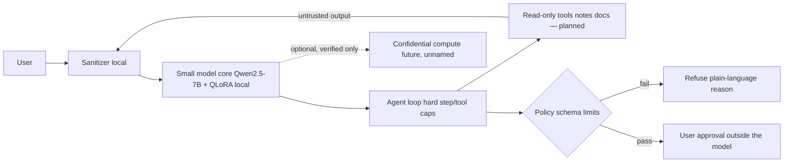

# Architecture — Salomon

> **Salomon is a local-first AI app for Android — a private personal research agent that keeps work on-device by default, fails closed without a local model, and never puts credentials in the model.**
> Product lock 2026-10-29 ~18:55 PDT (America/Vancouver). Design goal: local-first; fail closed; credentials out of the model; refuse secrets. Android app not shipped — today = web companion + privacy foundation. Source-ID mask = M2 (not opened); approval UX = M3 (not opened).

## Diagram

> Every arrow fails closed: no verification means no remote call; no policy pass means no action; a detected secret is refused, not echoed.

## Layers
1. **Small model core.** Qwen2.5-7B-Instruct + QLoRA, with Qwen2.5-0.5B for CPU smoke tests. It is gated by refusal eval R1/R2/R3 (secret echo, crime assist, prompt injection), and CI exits 1 on any fail. 7B passes 8/8 (signed). It runs locally by default.
2. **Sanitizer.** Today: **rejects secrets** (and redacts address-like strings where that path exists) on input; wraps `role:tool` output as untrusted data (`privacy/sanitizer.py`, TS parity in `phase2/SANITIZER.md`). **Source-ID / general PII masking before the model is M2 — not shipped** (bar: `docs/acceptance/PHASE3_M2_SOURCE_MASK_ACCEPT.md`). Do not claim live source-identity masking until M2 ACCEPT.
3. **Agent loop.** Tool calling with hard step and tool caps (`phase2/src/agentLoop.ts`). Read-only first. Anything that would change state is **propose-only**: the model emits a structured proposal, policy checks it, and the user approves.
4. **Policy engine.** Schema validation, allowlists, rate and spend limits (`privacy/policy_spend.py` is a stub; its counters are non-durable).
5. **Verified-remote (optional, future).** Used only when local hardware isn't enough, and only for environments that pass the fail-closed verification client (`phase1.5-attestation/`) against a pinned allowlist. No provider is named.

## Mapping to the research workflow
| Workflow step | Salomon layer | State today |
|---|---|---|
| Read notes, transcripts, documents | Read-only tools → sanitizer → model | Loop + sanitizer **built**. Local file/notes tools **not built** (Phase 3) |
| Summarize or query without leaking secrets | Refusal / must-not-echo model + sanitizer | Refusal eval **signed** (7B 8/8). Domain refresh **pending** dataset unpark |
| Handle hostile material (leaked docs, web pages) | Tool output wrapped UNTRUSTED; R3 injection gate | **Built + gated** |
| Send, publish, upload, change | Propose → policy → user approval | Pattern **reviewed** (Phase 2 M4 propose-only). No research write tools built. Execute was never opened |
| Credentials (mail, storage) | Host-side store, never in the model | Rule enforced in design. Store **not built** (Phase 3) |

Phase 2's read-only tool pattern (allowlist guards, caps, untrusted envelopes) proves the loop, caps and sanitizer but are not research tools.

## Security principles
- The model never holds raw keys, tokens or passwords.
- Proposal → schema validation → policy → human approval → execution outside the model.
- Refuses fraud, doxxing or credential theft.
- Everything the agent reads (web, email, files, tool output) is treated as hostile input.

## Phases (see ROADMAP.md)
1. Small model + refusal: gate done; dataset parked
1.5. Privacy merge gate: (1)–(5) signed
2. Agent loop, sanitizer, caps, propose-only: M1–M3 green
3. Android MVP (goal): local ask on phone; today Next.js web + `POST /api/ask`; CLI secondary; notes/docs ingest (M2), credential store, propose-only approval (M3) — M2/M3 not shipped
4. Hardening + optional confidential compute
