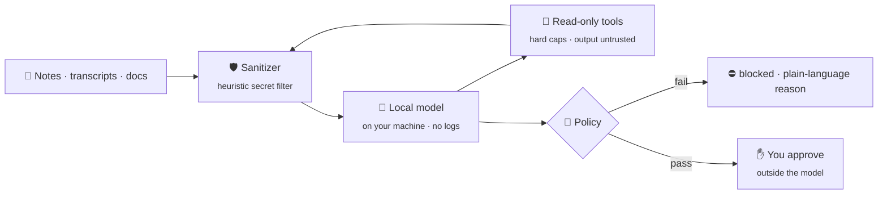
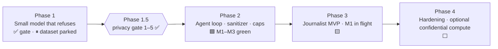

# Salomon

> **A local research agent for journalists and investigators that protects sources.**


  

1. **Sources stay local (goal).** Research is designed to run on your machine by default — not in a logged cloud chat. Phase 3 M1 (local `ask`) is in flight; the demo app may run in a labeled `DEMO · REMOTE` / `DEMO · stub` mode.
2. **Secrets are refused, not stored.** The model won’t echo keys or sensitive material, and it never holds credentials.
3. **You decide every consequential step.** The agent proposes; policy and you approve before anything is sent, published, or changed.



---

## Who it's for

Investigative and freelance journalists, small newsrooms, and researchers working with confidential sources. These are people whose notes, transcripts and documents can identify someone.

## The problem

Exposing a source can end a career or put a person at risk. Most AI tools add leak surfaces that a reporter can't see or control.

| Failure mode | What it costs |
|---|---|
| Interview notes pasted into a cloud chatbot | The text sits in provider logs and retention, where it can be subpoenaed, breached or used for training |
| The assistant repeats a name, number or document detail it was told to protect | The source is identified in a draft, a summary or a shared file |
| An agent reads a web page or a leaked document that contains hidden instructions | The injection steers what the agent does next |
| An agent holds your email or storage credentials | One bad completion sends, uploads or changes something you never approved |
| Remote inference that "just trusts" the host | No proof that the operator can't read the request |

## How Salomon handles it

- **Local-first, fail closed.** It runs on your hardware by default with logs off. Offline mode fails closed on a cache miss.
- **Refuse / must-not-echo.** A tuned 7B-class model is gated by a refusal eval that fails CI on any secret echo, crime assist or prompt-injection slip.
- **Sanitizer on every boundary.** A heuristic filter redacts common secret patterns (plus limited PII) on input and before any remote call; it is not a complete PII guarantee. All tool output is wrapped as untrusted data. Source-ID masking is Phase 3 **M2 — criteria accepted, not opened, not shipped** ([criteria](docs/acceptance/PHASE3_M2_SOURCE_MASK_ACCEPT.md)).
- **Read-only tools, hard caps.** The agent loop enforces step and tool limits. Anything that would send, publish or change something is **propose-only**.
- **Credentials outside the model.** The host holds them. The model never sees raw keys, tokens or passwords.
- **Plain-language refusals.** When Salomon refuses or strips something, it says why.
- **Optional confidential compute (future).** If a bigger model is needed, remote calls go only to an environment that passes a fail-closed verification check. No proof means no call. No provider is named or required.

**Salomon is not:** a replacement for editorial, legal or source-protection judgment, a cloud service, or an agent that acts without your approval.

## Where we are



- **Phase 1 (gate done).** Qwen2.5-7B-Instruct + QLoRA harness. The refusal eval passes **8/8** on 7B (`docs/signoffs/SECURITY_SIGNOFF_REFUSAL_7B.md`), and the R3 near-echo delta is cleared. Dataset expansion is **parked** at 362 seed rows. When it unparks, the data gets refreshed toward sources, PII and secrets in journalism.
- **Phase 1.5 (signed).** Threat model, fail-closed verified-remote client, sanitizer, policy stub and refusal eval: items (1)–(5) are signed off in `docs/signoffs/`.
- **Phase 2 (M1–M3 green).** Agent loop with hard caps, TS sanitizer on `role:tool` output, multi-step read-only tool chaining, and a reviewed propose-only pattern. Execute/sign was never opened. The safe agent-loop pattern (caps, sanitizer, propose-only) is green; research web dogfood is **Phase 3 M1 in flight** (local ask path). Ingest/mask (M2) and propose-save (M3) are **not shipped**.
- **Phase 3 (M1 in flight, not green).** Primary surface: Next.js web app + `POST /api/ask`; CLI secondary. M1 is not green until desk → `/api/ask` + offline smoke pass. A Q4_K_M GGUF is pinned and scripts exist, but there is **no live local GGUF** until Runtime smoke is green.
- **Archived prior work:** an earlier crypto/NEAR framing. See [crypto-near-track](docs/archive/crypto-near-track.md) · [near/](docs/archive/near/).

Status of record: [STATUS.md](STATUS.md) · plan: [ROADMAP.md](ROADMAP.md) · design: [ARCHITECTURE.md](ARCHITECTURE.md).

## Repo map

```
.
├── README.md  ARCHITECTURE.md  ROADMAP.md  STATUS.md  PROGRESS.md
├── SECURITY.md  .gitignore
├── docs/            archive · acceptance · threat-models · reviews · signoffs · notes  (index: docs/README.md)
├── phase1.5-attestation/   fail-closed remote-verify client + model allowlist
├── phase2/          agent loop, read-only tools, sanitizer, propose-only pattern
├── privacy/         sanitizer + policy/spend stubs
└── phase1-slm/      model config, dataset builder, QLoRA, refusal eval, local inference
```

## Quickstart (phase1-slm)

```bash
cd phase1-slm
python3.11 -m venv .venv && source .venv/bin/activate
pip install -r requirements.txt
make data           # build + secret-scan dataset
make test-safety    # harness unit tests (no GPU)
make eval-refusal   # CI safety gate (exit 1 on any fail)
make dryrun         # tiny LoRA on CPU
```
For the 7B gate, open `notebooks/eval_refusal_7b_colab.ipynb` in Colab, choose a GPU runtime, then **Run all**.

## Security principles

- **No secrets in the model, ever.** Keys and credentials live outside it; anything consequential needs policy plus your approval.
- **Fail closed.** No verification → no remote call. Policy fail → no action. Secret-scan hit → no dataset.
- **Local first.** Offline by default, prompt logs off, heuristic secret/PII redaction before any remote call (source-ID mask = M2, not shipped).
- **Everything the agent reads is untrusted.** Web pages, emails, files and tool output are treated as possible injection.

## Docs

[ARCHITECTURE](ARCHITECTURE.md) · [ROADMAP](ROADMAP.md) · [STATUS](STATUS.md) · [SECURITY](SECURITY.md) · [phase1-slm/README](phase1-slm/README.md) · [Archived crypto track](docs/archive/crypto-near-track.md) · [docs/archive/near/](docs/archive/near/)

---

🔒 This repo stays **private** until the architecture and security model are stable. It contains no secrets, real keys, user PII or source material.
