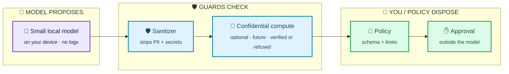
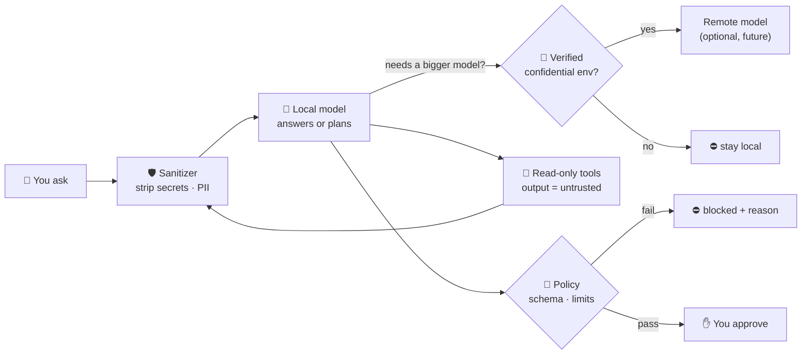
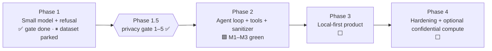

# Salomon — privacy-first AI that keeps your secrets

> **A personal and agent AI that runs close to you, refuses to leak what it shouldn't, and never holds your keys.**
> Local-first small model → sanitizer → safe, propose-only tools → *you* decide.


  




---

## The problem

Assistants and agents are being handed our inboxes, files, credentials and tools — and most of them leak by design.

| Today | What goes wrong |
|---|---|
| 🔑 People paste passwords, API keys and recovery phrases into chatbots | Secrets land in prompts, logs and training data |
| 📝 Every prompt is logged server-side | Your work, health and money become a profile |
| ☁️ Remote inference "just trusts" the host | No proof the operator can't read or alter your request |
| 💉 Agents read web pages, emails and tool output | Attackers inject instructions straight into the agent |
| 🤖 Agents hold live credentials to "be helpful" | One bad completion = leaked data or an action you never wanted |

## Salomon's answer

1. **Small models that refuse to leak.** A tuned 7B-class model, gated by a refusal / must-not-echo eval that fails CI on any secret echo, crime assist or prompt-injection slip.
2. **Local-first inference.** Runs on your hardware by default, logs off, offline mode fails closed.
3. **Sanitizer on every boundary.** PII and secrets are stripped before anything leaves the device, and tool output is treated as untrusted data.
4. **Safe agent tools.** Read-only by default, hard step/tool caps, propose-only for anything that would change the world. The model never holds keys or credentials.
5. **Optional confidential compute (future).** When a bigger model is needed, remote calls go only to hardware-verified confidential environments. No proof → no call.

## Why it matters

| | Typical assistant / agent | **Salomon** |
|---|---|---|
| **Secrets** | Pasted into chats, held by agents | Never enter the model; refused and not echoed |
| **Privacy** | Prompts logged remotely by default | Local by default, logs off, PII stripped |
| **Remote inference** | Trust the provider | Verified confidential compute or stay local |
| **Agent actions** | Model output → action | Model *proposes* → policy → explicit approval |
| **Injection** | Untested | Gated: R3 prompt-injection eval must pass |

---

## How a request flows



The model **proposes**. It never holds keys and never acts alone. Every arrow fails closed. Details: [ARCHITECTURE.md](ARCHITECTURE.md).

## Where we are



- **Phase 1 — small model that refuses.** Qwen2.5-7B-Instruct + QLoRA harness; refusal eval **8/8** on 7B (`docs/signoffs/SECURITY_SIGNOFF_REFUSAL_7B.md`), R3 near-echo delta cleared (`docs/signoffs/SECURITY_SIGNOFF_R3_NEARECHO_DELTA.md`). Dataset expansion is **parked** at 362 seed rows.
- **Phase 1.5 — privacy merge gate.** Threat model, fail-closed remote-verify client, sanitizer, policy/spend stub, refusal eval: items (1)–(5) **signed off** (`docs/signoffs/`).
- **Phase 2 — agent capabilities.** Agent loop with hard caps, read-only tools, TS sanitizer on `role:tool` output, verified-remote model calls (M1–M3 **green**; `phase2/EVIDENCE_PHASE2_M3_MULTI_TOOL.md`). A propose-only action sketch passed review and is kept as a **safe-tooling pattern**; execute/sign was never opened.
- **Archived prior work.** The project began with a crypto/on-chain framing (on-chain tools, intents settlement, contracts, staking-for-credits, a specific cloud TEE provider). That is no longer the product story; evidence stays in `docs/` and `phase2/` as engineering history.

Status of record: [STATUS.md](STATUS.md) · plan: [ROADMAP.md](ROADMAP.md).

## Repo map

```
.
├── README.md  ARCHITECTURE.md  ROADMAP.md  STATUS.md  PROGRESS.md
├── SECURITY.md  .gitignore
├── docs/            acceptance · threat-models · reviews · signoffs · notes  (index: docs/README.md)
├── phase1.5-attestation/   fail-closed remote-verify client + model allowlist
├── phase2/          agent loop, read-only tools, sanitizer, propose-only stubs
├── privacy/         sanitizer + policy/spend stubs
└── phase1-slm/      model config, dataset builder, QLoRA, refusal eval, local inference
```

## Quickstart (phase1-slm)

```bash
cd phase1-slm
python3.11 -m venv .venv && source .venv/bin/activate
pip install -r requirements.txt
make data           # build + secret-scan dataset
make test-safety    # harness unit tests (no GPU)
make eval-refusal   # CI safety gate (exit 1 on any fail)
make dryrun         # tiny LoRA on CPU
```
For the 7B gate, open `notebooks/eval_refusal_7b_colab.ipynb` in Colab, choose a GPU runtime, then **Run all**.

## Security principles

- **No secrets in the model, ever.** Keys and credentials live outside it; anything consequential needs policy plus your approval.
- **Fail closed.** No verification → no remote call. Policy fail → no action. Secret-scan hit → no dataset.
- **Local first.** Offline by default, prompt logs off, PII stripped before any remote call.
- **Everything the agent reads is untrusted.** Web pages, emails, files and tool output are treated as possible injection.

## Docs

[ARCHITECTURE](ARCHITECTURE.md) · [ROADMAP](ROADMAP.md) · [STATUS](STATUS.md) · [SECURITY](SECURITY.md) · [phase1-slm/README](phase1-slm/README.md)

---

🔒 This repo stays **private** until the architecture and security model are stable. It contains no secrets, real keys or user PII.
