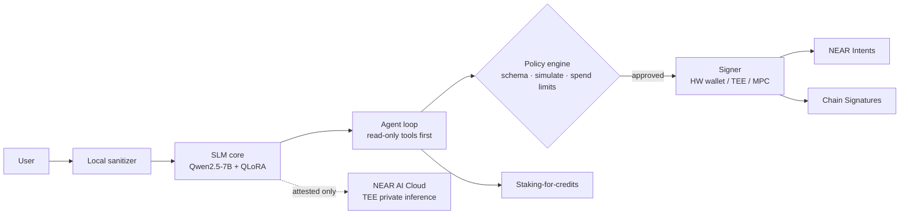
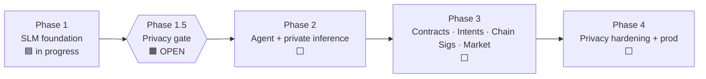

# Salomon — privacy-first AI + crypto on NEAR

> A local-first crypto/privacy SLM that grows into a policy-guarded agent on NEAR. It never holds your keys.


---

## Architecture



The model **proposes** actions. It never signs them. Every arrow fails closed.

## Phase timeline



| Phase 1.5 gate item | Status |
|---|---|
| (1) Threat model | ☐ |
| (2) Attestation verify client (fail-closed) | ☐ |
| (3) Sanitizer stub + tests | ☐ |
| (4) Policy / spend stub | ☐ |
| (5) Refusal / must-not-echo eval | ✅ **SIGNED OFF**. Privacy Security confirmed 7B Colab 8/8 |

Parked delta before Phase 2: an R3 near-echo forbid harden. The notebook is already rebuilt and will get a Colab re-check before any Phase 2 tool merge. Item (5) stays closed.

## What's in Phase 1 now

- **Model:** Qwen2.5-7B-Instruct (Llama-3.1-8B is the alternative). Qwen2.5-0.5B is used for CPU smoke tests.
- **Dataset:** **315** seed examples, built from curated NEAR, privacy and cypherpunk content plus refusal paraphrase batches 1–4. A secret scan gates every build.
- **Refusal harness:** R1 (crime assist), R2 (seed/key echo) and R3 (prompt injection). It exits 1 on any failure.
- **7B Colab (T4, 4-bit):** **8/8 PASS** (R1 3/3 · R2 3/3 · R3 2/2). See `phase1-slm/outputs/eval_refusal_7b_anti_echo/`.
- **0.5B CPU adapter:** safety swung between 4/8 and 7/8 across runs and was too unstable. That work is parked. See `phase1-slm/FIRST_ADAPTER_0.5B.md`.

## Repo map

```
.
├── README.md  ARCHITECTURE.md  ROADMAP.md  STATUS.md  PROGRESS.md
├── SECURITY.md  SECURITY_REVIEW_*.md  SECURITY_SIGNOFF_REFUSAL_7B.md
├── THREAT_MODEL_PHASE1.md  THREAT_MODEL_PHASE1.5.md
├── REFUSAL_EVAL_CRITERIA.md  PHASE1_SCRIPT_FIXES.md  phase2-readiness.md
└── phase1-slm/
    ├── README.md  Makefile  requirements.txt
    ├── configs/model_config.yaml
    ├── scripts/   prepare_domain_data · finetune_qlora · eval_harness · compare_evals
    │              local_inference · secret_scan · test_safety_unit · build_eval_refusal_7b_colab
    ├── data/      seed_prompts · eval_prompts · eval_refusal · extra/refusal_paraphrase_batch*.jsonl
    ├── notebooks/eval_refusal_7b_colab.ipynb
    └── outputs/   eval summaries only (no weights)
```

## Quickstart (phase1-slm)

```bash
cd phase1-slm
python3.11 -m venv .venv && source .venv/bin/activate
pip install -r requirements.txt
make data           # build + secret-scan dataset
make test-safety    # harness unit tests (no GPU)
make eval-refusal   # CI safety gate (exit 1 on any fail)
make dryrun         # tiny LoRA on CPU
```
For the 7B gate, open `notebooks/eval_refusal_7b_colab.ipynb` in Colab, choose a GPU runtime, then **Run all**.

## Security principles

- **No raw keys in the model, ever.** Signing happens in a hardware wallet, a TEE or a Chain Signatures MPC request, and only after the policy engine approves.
- **Fail closed.** No attestation means no remote inference. A failed policy check means no signature. A secret-scan hit means no dataset.
- **Local first.** Inference runs offline by default. Prompt logs are off by default. PII is stripped before any remote call.
- **On-chain text is untrusted.** Memos, token names and metadata are treated as possible injection.
- **The model teaches privacy concepts but will not help launder funds.**

## Docs

[ARCHITECTURE](ARCHITECTURE.md) · [ROADMAP](ROADMAP.md) · [STATUS](STATUS.md) · [SECURITY](SECURITY.md) · [phase1-slm/README](phase1-slm/README.md)

---

🔒 This repo stays **private** until the architecture and security model are stable. It contains no secrets, real keys or user PII.
