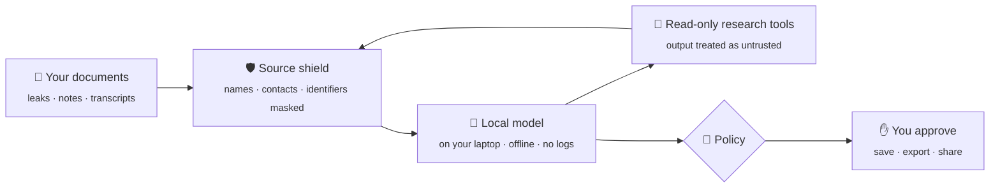
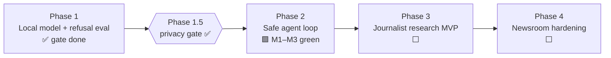

# Salomon — the local research agent that protects your sources

> **For journalists and investigators.** Read leaks, transcripts and notes with an AI that runs on your laptop, never phones home, and refuses to expose who told you what.


  




---

## The problem

Reporters now paste sensitive material into cloud chatbots to keep up — and every paste is a potential source burn.

| Today | What goes wrong |
|---|---|
| ☁️ Leaked documents uploaded to cloud AI | Copies sit in provider logs, reachable by subpoena or breach |
| 🗣️ Interview notes and transcripts summarized remotely | Source names, phone numbers and metadata leave the newsroom |
| 💉 Agents read hostile PDFs, emails and web pages | A planted instruction can make the agent leak or misreport |
| 🤖 AI tools "helpfully" quote identifying details back | One careless export exposes a confidential source |

## What Salomon does

1. **Runs on your machine.** A small local model (Qwen2.5-7B-class, quantized) — offline by default, prompt logs off, fails closed when the network isn't allowed.
2. **Shields sources.** A sanitizer masks names, contacts, secrets and identifiers on every boundary; a CI-gated **must-not-echo** eval fails the build if the model repeats protected details.
3. **Treats documents as hostile.** Everything the agent reads — leaks, emails, web pages, tool output — is wrapped as untrusted data. Prompt-injection is a tested gate (R3).
4. **Researches safely.** An agent loop with hard step/tool caps and read-only tools: summarize, cross-reference, build timelines. Anything that saves, exports or shares is **propose-only** and needs your approval.
5. **Never trusts a remote model blindly.** If you ever opt into a bigger remote model, a fail-closed verifier refuses any environment it can't verify. No proof → stays local.

## Why it matters

| | Cloud AI assistant | **Salomon** |
|---|---|---|
| **Where documents go** | Uploaded, logged | Stay on your device |
| **Source identities** | Freely quoted back | Masked; echo is a CI failure |
| **Hostile documents** | Instructions obeyed | Treated as untrusted data |
| **Actions** | Model output → action | Model proposes → policy → you approve |
| **Remote compute** | Trust the provider | Verified or refused |

---

## Where we are



- **Phase 1 — local model that won't leak.** Qwen2.5-7B-Instruct + QLoRA harness; refusal / must-not-echo eval **8/8** on 7B (`docs/signoffs/SECURITY_SIGNOFF_REFUSAL_7B.md`); R3 near-echo cleared. Dataset expansion parked at 362 seed rows.
- **Phase 1.5 — privacy merge gate.** Threat model, fail-closed remote-verify client (kept as a pattern), sanitizer, policy stub, refusal eval — items (1)–(5) **signed off**.
- **Phase 2 — safe agent loop.** Hard caps, read-only tools, TS sanitizer on `role:tool` output, multi-step chaining (M1–M3 **green**). Propose-only action pattern reviewed; execute/sign never opened.
- **Next — Phase 3:** local document ingest, source-protection layer, research workspace (CLI first). See [ROADMAP.md](ROADMAP.md).

Earlier crypto / on-chain experiments are **parked** — index in [`docs/archive/crypto/`](docs/archive/crypto/README.md).

## Repo map

```
.
├── README.md  ARCHITECTURE.md  ROADMAP.md  STATUS.md  PROGRESS.md  SECURITY.md
├── docs/                  acceptance · threat-models · reviews · signoffs · notes · archive  (index: docs/README.md)
├── phase1-slm/            local model config, dataset builder, QLoRA, refusal eval, inference
├── phase1.5-attestation/  fail-closed remote-verify client (pattern)
├── phase2/                agent loop, read-only tools, sanitizer, propose-only pattern
└── privacy/               sanitizer + policy stubs
```

## Quickstart (phase1-slm)

```bash
cd phase1-slm
python3.11 -m venv .venv && source .venv/bin/activate
pip install -r requirements.txt
make data           # build + secret-scan dataset
make test-safety    # harness unit tests (no GPU)
make eval-refusal   # CI safety gate (exit 1 on any fail)
make dryrun         # tiny LoRA on CPU
```
For the 7B gate, open `notebooks/eval_refusal_7b_colab.ipynb` in Colab with a GPU runtime and **Run all**.

## Principles

- **Sources first.** Identifying details never leave the device and never get echoed.
- **Fail closed.** No verification → no remote call. Policy fail → no action. Secret-scan hit → no dataset.
- **Local by default.** Offline, logs off.
- **Every document is untrusted.** Leaks, emails, pages and tool output are possible injection.

## Docs

[ARCHITECTURE](ARCHITECTURE.md) · [ROADMAP](ROADMAP.md) · [STATUS](STATUS.md) · [SECURITY](SECURITY.md) · [Product niche](docs/notes/PRODUCT_NICHE.md) · [docs index](docs/README.md)

---

🔒 Private until the architecture and security model are stable. Contains no secrets, real keys or user PII.
