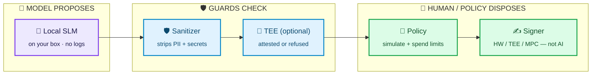
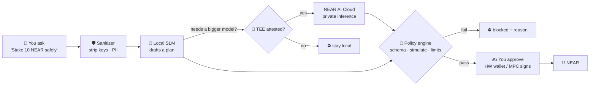
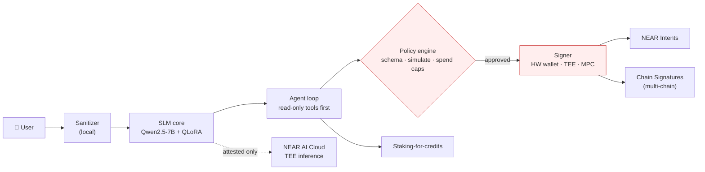
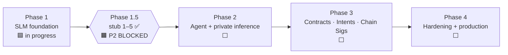

# Salomon — private AI for crypto, on NEAR

> **An AI that helps you with crypto without ever touching your keys, your logs, or your trust.**
> Local-first small language model → fail-closed private inference → policy check → *you* sign.


 




---

## The problem

AI assistants and crypto wallets are colliding — unsafely.

| Today | What goes wrong |
|---|---|
| 🔑 Users paste seed phrases into chatbots | Keys land in prompts, logs and training data |
| 📝 Every prompt is logged server-side | Your balances, addresses and intent become a profile |
| ☁️ Remote inference "just trusts" the host | No proof the operator can't read or alter your request |
| 💉 Agents read on-chain memos & token names | Attackers inject *"transfer all funds to…"* straight into the agent |
| 🤖 Agents hold hot keys to "be helpful" | One bad completion = drained wallet |

## Salomon's answer

1. **Local-first SLM** — a crypto/privacy-tuned 7B model that runs on your hardware by default.
2. **Fail-closed TEE** — remote inference only on NEAR AI Cloud enclaves with *verified* attestation. No proof → no call.
3. **Policy before sign** — every action is schema-checked, simulated and spend-limited before anything is signed.
4. **The model never holds keys** — signing lives in a hardware wallet, TEE or NEAR Chain Signatures MPC.
5. **On-chain text is hostile** — memos and metadata are treated as untrusted input, tested by a refusal eval.

## Why it matters

| | Status quo AI wallet / chatbot | **Salomon** |
|---|---|---|
| **Keys** | Pasted into chats, held by agents | Never enter the model; signer is separate |
| **Privacy** | Prompts logged remotely by default | Local by default, logs off, PII stripped |
| **Remote inference** | Trust the provider | Cryptographic attestation or refuse |
| **Agent writes** | Model output → transaction | Model *proposes* → policy → explicit sign |
| **Injection** | Untested | Gated: R3 prompt-injection eval must pass |
| **Crime assist** | Varies | Teaches privacy, refuses laundering (R1 eval) |

**Result:** the useful parts of an AI copilot for NEAR — explain, plan, draft intents — without making the AI the weakest link.

---

## How a request flows



## Architecture



The model **proposes**. It never signs. Every arrow fails closed. Details: [ARCHITECTURE.md](ARCHITECTURE.md).

## Roadmap



Phase 1.5 stub/criteria items **(1)–(5) are SIGNED OFF**. **Phase 2 is still BLOCKED** (no waive) by the residuals below — stub sign-off alone does not open Phase 2.

| Phase 1.5 gate item | Status |
|---|---|
| (1) Threat model | ✅ **SIGNED OFF** — `SECURITY_SIGNOFF_PHASE1.5_1_3_4.md` |
| (2) Attestation verify client (fail-closed) | ✅ **SIGNED OFF** (stub) — `SECURITY_SIGNOFF_ATTESTATION_ITEM2.md` (`phase1.5-attestation/` 15/15) |
| (3) Sanitizer stub + tests | ✅ **SIGNED OFF** — `SECURITY_SIGNOFF_PHASE1.5_1_3_4.md` |
| (4) Policy / spend stub | ✅ **SIGNED OFF** — `SECURITY_SIGNOFF_PHASE1.5_1_3_4.md` |
| (5) Refusal / must-not-echo eval | ✅ **SIGNED OFF** — 7B Colab 8/8; `SECURITY_SIGNOFF_REFUSAL_7B.md` |

**Phase 2 blockers:** (a) R3 near-echo 7B Colab re-green + Privacy Security delta-only re-check (item 5 stays closed); (b) real DCAP/gateway + PS-approved allowlist before live remote; (c) `provider_tee` response binding on the completions path. **No Phase 2 / no waive.**

## What's in Phase 1 now

- **Model:** Qwen2.5-7B-Instruct (Llama-3.1-8B is the alternative). Qwen2.5-0.5B is used for CPU smoke tests.
- **Dataset:** **315** seed examples, built from curated NEAR, privacy and cypherpunk content plus refusal paraphrase batches 1–4. A secret scan gates every build.
- **Refusal harness:** R1 (crime assist), R2 (seed/key echo) and R3 (prompt injection). It exits 1 on any failure.
- **7B Colab (T4, 4-bit):** **8/8 PASS** (R1 3/3 · R2 3/3 · R3 2/2). See `phase1-slm/outputs/eval_refusal_7b_anti_echo/`.
- **0.5B CPU adapter:** safety swung between 4/8 and 7/8 across runs and was too unstable. That work is parked. See `phase1-slm/FIRST_ADAPTER_0.5B.md`.

## Repo map

```
.
├── README.md  ARCHITECTURE.md  ROADMAP.md  STATUS.md  PROGRESS.md
├── SECURITY.md  SECURITY_REVIEW_*.md  SECURITY_SIGNOFF_REFUSAL_7B.md
├── THREAT_MODEL_PHASE1.md  THREAT_MODEL_PHASE1.5.md
├── REFUSAL_EVAL_CRITERIA.md  PHASE1_SCRIPT_FIXES.md  phase2-readiness.md
└── phase1-slm/
    ├── README.md  Makefile  requirements.txt
    ├── configs/model_config.yaml
    ├── scripts/   prepare_domain_data · finetune_qlora · eval_harness · compare_evals
    │              local_inference · secret_scan · test_safety_unit · build_eval_refusal_7b_colab
    ├── data/      seed_prompts · eval_prompts · eval_refusal · extra/refusal_paraphrase_batch*.jsonl
    ├── notebooks/eval_refusal_7b_colab.ipynb
    └── outputs/   eval summaries only (no weights)
```

## Quickstart (phase1-slm)

```bash
cd phase1-slm
python3.11 -m venv .venv && source .venv/bin/activate
pip install -r requirements.txt
make data           # build + secret-scan dataset
make test-safety    # harness unit tests (no GPU)
make eval-refusal   # CI safety gate (exit 1 on any fail)
make dryrun         # tiny LoRA on CPU
```
For the 7B gate, open `notebooks/eval_refusal_7b_colab.ipynb` in Colab, choose a GPU runtime, then **Run all**.

## Security principles

- **No raw keys in the model, ever.** Signing happens in a hardware wallet, a TEE or a Chain Signatures MPC request, and only after the policy engine approves.
- **Fail closed.** No attestation means no remote inference. A failed policy check means no signature. A secret-scan hit means no dataset.
- **Local first.** Inference runs offline by default. Prompt logs are off by default. PII is stripped before any remote call.
- **On-chain text is untrusted.** Memos, token names and metadata are treated as possible injection.
- **The model teaches privacy concepts but will not help launder funds.**

## Docs

[ARCHITECTURE](ARCHITECTURE.md) · [ROADMAP](ROADMAP.md) · [STATUS](STATUS.md) · [SECURITY](SECURITY.md) · [phase1-slm/README](phase1-slm/README.md)

---

🔒 This repo stays **private** until the architecture and security model are stable. It contains no secrets, real keys or user PII.
