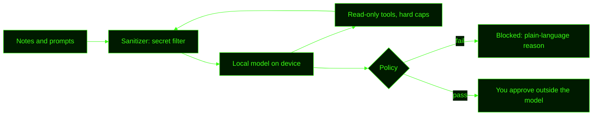

# Salomon

> **Salomon is a local-first AI app for Android — a private personal research agent that keeps work on-device by default, fails closed without a local model, and never puts credentials in the model.**

Private local AI for personal research. On-device by default; fail closed; credentials stay out of the model; refuse secrets. Remote only if the user opts in and the path is labeled — never a silent fallback.

> Status: Android app / Play listing / on-device phone inference **not shipped yet**; today's surface is the web companion + privacy foundation.


  

1. **Local-first, fail closed (goal).** The model is designed to run on-device by default and fail closed when no local model is connected. Phase 3 M1 (local `ask`) is in flight; the current surface is a Next.js web app that may run in a labeled `DEMO · REMOTE` / `DEMO · stub` mode. Remote paths are opt-in and labeled — never silent, never default.
2. **Secrets are refused, not stored.** The model won’t echo keys or sensitive material, and it never holds credentials or seed material. Anything that would sign, send or change something stays outside the model.
3. **You decide every consequential step.** The agent proposes; policy and you approve before anything is sent, published, signed or changed.



Flow in words: notes go through the sanitizer into a local model; read-only tools loop back through the sanitizer; policy either blocks with a plain reason or asks you to approve outside the model.

---

## Why Android

Android (Google Play or APK) is the primary product path so a private agent can live on the phone people already use. The web app is a companion surface. The Android app is not shipped yet — this is the product direction.

> Today's code is the privacy foundation (sanitizer, local ask path, refusal gates) plus the web companion. See [STATUS.md](STATUS.md).

## Who it's for

People who want a private local AI / personal research agent on their phone and a web companion — professional, privacy-first. Niche: [docs/notes/PRODUCT_NICHE.md](docs/notes/PRODUCT_NICHE.md).

## How Salomon handles it

- **Local-first, fail closed.** Designed to run on your device by default with logs off; remote is opt-in and labeled. Offline mode fails closed on a cache miss.
- **Refuse / must-not-echo.** A tuned 7B-class model is gated by a refusal eval that fails CI on any secret echo, crime assist or prompt-injection slip.
- **Sanitizer on every boundary.** A heuristic filter redacts common secret patterns (plus limited PII) on input and before any remote call; it is not a complete PII guarantee. All tool output is wrapped as untrusted data. Source-ID masking is Phase 3 **M2 — criteria accepted, not opened, not shipped** ([criteria](docs/acceptance/PHASE3_M2_SOURCE_MASK_ACCEPT.md)).
- **Read-only tools, hard caps.** The agent loop enforces step and tool limits. Anything that would send, publish or change something is **propose-only**.
- **Credentials outside the model.** The host holds them. The model never sees raw keys, tokens or passwords.
- **Plain-language refusals.** When Salomon refuses or strips something, it says why.
- **Optional confidential compute (future).** If a bigger model is needed, remote calls go only to an environment that passes a fail-closed verification check. No proof means no call. No provider is named or required.

**Salomon is not:** a cloud-by-default service, or an agent that acts without your approval.

## Where we are

```mermaid
%%{init: {'theme':'dark','themeVariables':{'dark':'#0a0a0a','background':'#0a0a0a','primaryColor':'#003b00','primaryTextColor':'#39ff14','primaryBorderColor':'#39ff14','secondaryColor':'#001a00','secondaryTextColor':'#39ff14','secondaryBorderColor':'#00ff41','tertiaryColor':'#002200','lineColor':'#39ff14','textColor':'#39ff14','mainBkg':'#001a00','nodeBorder':'#39ff14','clusterBkg':'#000000','titleColor':'#39ff14','edgeLabelBackground':'#001a00'}}}%%
flowchart LR
  P1["Phase 1: small model that refuses (gate done, dataset parked)"] --> G["Phase 1.5: privacy gate 1-5 signed"]
  G --> P2["Phase 2: agent loop, sanitizer, caps (M1-M3 green)"]
  P2 --> P3["Phase 3: Android MVP (M1 in flight)"]
  P3 --> P4["Phase 4: hardening, optional confidential compute"]

  classDef neon fill:#001a00,stroke:#39ff14,color:#39ff14
  class P1,G,P2,P3,P4 neon
```



| Phase | Status |
|---|---|
| Phase 1 — small model that refuses | Gate done; dataset parked |
| Phase 1.5 — privacy gate items 1–5 | Signed |
| Phase 2 — agent loop, sanitizer, caps | M1–M3 green |
| Phase 3 — local ask MVP | M1 in flight (not green) |
| Phase 4 — hardening, optional confidential compute | Not started |

- **Phase 1 (gate done).** Qwen2.5-7B-Instruct + QLoRA harness. The refusal eval passes **8/8** on 7B (`docs/signoffs/SECURITY_SIGNOFF_REFUSAL_7B.md`), and the R3 near-echo delta is cleared. Dataset expansion is **parked** at 362 seed rows. When it unparks, the data gets refreshed toward general privacy (PII, secrets, keys).
- **Phase 1.5 (signed).** Threat model, fail-closed verified-remote client, sanitizer, policy stub and refusal eval: items (1)–(5) are signed off in `docs/signoffs/`.
- **Phase 2 (M1–M3 green).** Agent loop with hard caps, TS sanitizer on `role:tool` output, multi-step read-only tool chaining, and a reviewed propose-only pattern. Execute/sign was never opened. The safe agent-loop pattern (caps, sanitizer, propose-only) is green; research web dogfood is **Phase 3 M1 in flight** (local ask path). Ingest/mask (M2) and propose-save (M3) are **not shipped**.
- **Phase 3 (M1 in flight, not green).** **Goal surface:** Android app (not shipped). **Today:** Next.js web app + `POST /api/ask`; CLI secondary. M1 is not green until desk → `/api/ask` + offline smoke pass. A Q4_K_M GGUF is pinned and scripts exist, but there is **no live local GGUF** / on-device phone inference until that lands.
- **Prior framing:** earlier niche experiments were retired from the product narrative; this repo is pure local-first AI.

Status of record: [STATUS.md](STATUS.md) · plan: [ROADMAP.md](ROADMAP.md) · design: [ARCHITECTURE.md](ARCHITECTURE.md).

## Repo map

```
.
├── README.md  ARCHITECTURE.md  ROADMAP.md  STATUS.md  PROGRESS.md
├── SECURITY.md  .gitignore
├── docs/            archive · acceptance · threat-models · reviews · signoffs · notes  (index: docs/README.md)
├── phase1.5-attestation/   fail-closed remote-verify client + model allowlist
├── phase2/          agent loop, read-only tools, sanitizer, propose-only pattern
├── privacy/         sanitizer + policy/spend stubs
└── phase1-slm/      model config, dataset builder, QLoRA, refusal eval, local inference
```

## Quickstart (phase1-slm)

```bash
cd phase1-slm
python3.11 -m venv .venv && source .venv/bin/activate
pip install -r requirements.txt
make data           # build + secret-scan dataset
make test-safety    # harness unit tests (no GPU)
make eval-refusal   # CI safety gate (exit 1 on any fail)
make dryrun         # tiny LoRA on CPU
```
For the 7B gate, open `notebooks/eval_refusal_7b_colab.ipynb` in Colab, choose a GPU runtime, then **Run all**.

## Security principles

- **No secrets in the model, ever.** Keys and credentials live outside it; anything consequential needs policy plus your approval.
- **Fail closed.** No verification → no remote call. Policy fail → no action. Secret-scan hit → no dataset.
- **Local first.** Local by default (remote opt-in and labeled), prompt logs off, heuristic secret/PII redaction before any remote call (source-ID mask = M2, not shipped).
- **Everything the agent reads is untrusted.** Web pages, emails, files and tool output are treated as possible injection.

## Docs

[ARCHITECTURE](ARCHITECTURE.md) · [ROADMAP](ROADMAP.md) · [STATUS](STATUS.md) · [SECURITY](SECURITY.md) · [phase1-slm/README](phase1-slm/README.md)

---

🔒 This repo stays **private** until the architecture and security model are stable. It contains no secrets, real keys, user PII or source material.


