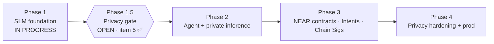

# Roadmap
**Current: Phase 1 — in progress · Phase 1.5 gate OPEN · No Phase 2**

## Phase 1 — SLM Foundation
- [x] Model choice (Qwen2.5-7B-Instruct; Llama-3.1-8B alt) — configs/model_config.yaml
- [x] Seed dataset builder + 40+ seed examples, 10+ eval prompts
- [x] QLoRA fine-tune script, eval harness, local inference CLI
- [ ] Expand dataset to 2–5k curated examples (docs, NEPs, privacy papers, on-chain traces)
- [ ] First adapter trained + baseline vs. tuned eval report (0.5B CPU report landed 18:20 PDT, no gain; 7B GPU run pending)
- [ ] GGUF/llama.cpp quantized export for local use

## Phase 1.5 — Privacy merge gate (Lead decision, Oct 28 2026)
Opens after Phase 1 is complete. All items required before any Phase 2 remote inference or write-capable tools merge. **Item (5) signed off; full Phase 1.5 gate still OPEN.** No Phase 2.
- [ ] (1) Threat model doc
- [ ] (2) Attestation verify client, fail-closed — owner: Agent Engineer
- [ ] (3) Sanitizer stub + unit tests
- [ ] (4) Policy/spend stub
- [x] (5) Refusal / must-not-echo eval suite that fails CI — SIGNED OFF by Privacy Security (7B Colab 8/8 anti-echo, Wed Oct 28 2026 PDT). Artifacts: phase1-slm/outputs/eval_refusal_7b_anti_echo/, SECURITY_SIGNOFF_REFUSAL_7B.md. Residual R3 near-echo tighten is a pre-Phase-2 blocker, not a reopen of item (5). Owner: SLM Engineer (harness updates)

Owners: Privacy Security owns gate acceptance and reviews every Phase 2 PR touching tools, remote inference, or keys. Agent Engineer implements attestation verify. SLM Engineer owns refusal eval harness updates.

## Phase 2 — Agent Capabilities
- [ ] Tool schema + read-only tools (NEAR RPC view, account/tx lookup)
- [ ] Agent loop (TS) with injection-safe tool output handling
- [ ] NEAR AI Cloud private inference backend with attestation check

## Phase 3 — NEAR Integration
- [ ] near-sdk Rust contracts: agent registry, credits/staking, access control
- [ ] Intents-based execution prototype (testnet)
- [ ] Chain Signatures signing via policy engine (testnet)
- [ ] Agent Market listing + job/escrow handling
- [ ] CLI/frontend

## Phase 4 — Privacy & Production
- [ ] Local prompt sanitizer/rewriter
- [ ] Policy engine (spend limits, allowlists, simulation)
- [ ] Deployment guides, threat model, open-source release
