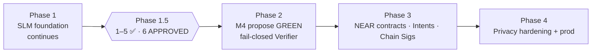

# Roadmap
**Current: Phase 2 — M4 propose sketch GREEN** · G2 ACCEPTED · soft polish **CLOSED** · settlement mainnet/G3 · Phase 1 gate done · dataset PARKED · Phase 1.5 (1)–(5) SIGNED · (6) APPROVED

## Phase 1 — SLM Foundation
- [x] Model choice (Qwen2.5-7B-Instruct; Llama-3.1-8B alt) — configs/model_config.yaml
- [x] Seed dataset builder + 40+ seed examples, 10+ eval prompts
- [x] QLoRA fine-tune script, eval harness, local inference CLI
- [ ] Expand dataset to 2–5k curated examples (docs, NEPs, privacy papers, on-chain traces) — **PARKED** 2026-10-29 (user via Lead): no 2k / multi-turn for now; seed 362; resume only when unparked
- [ ] First adapter trained + baseline vs. tuned eval report (0.5B CPU report landed 18:20 PDT, no gain; 7B GPU run pending)
- [ ] GGUF/llama.cpp quantized export for local use

## Phase 1.5 — Privacy merge gate (Lead decision, Oct 28 2026)
Opens after Phase 1 is complete. Stub/criteria items **(1)–(5) SIGNED OFF**. R3 near-echo **CLEARED**. Item **(6) APPROVED** — `z-ai/glm-5.3-flash` allowlist now **two** entries (`19aea169…` via `docs/signoffs/SECURITY_SIGNOFF_PRE_PHASE2_ITEM6_GLM.md`; `7bb9af0a…` via `docs/signoffs/SECURITY_SIGNOFF_PHASE2_SECOND_INSTANCE_GLM.md`, effective_from 2026-10-29T17:10:00Z; Abliterated DeepSeek/Qwen rejected). Phase 2 **IN PROGRESS**: **M1 GREEN** + **M2 landed** + **M3 GREEN** (`EVIDENCE_PHASE2_M3_MULTI_TOOL.md`; multi-step live PASS) + dual-instance live + sanitizer TS. Unknown instances DENY+retry. Soft polish **CLOSED**: formal GLM refusal stamp 8/8 (`docs/signoffs/SECURITY_SIGNOFF_GLM_LIVE_REFUSAL.md`); `compose_file_sha256` **MERGE APPROVED** (`docs/signoffs/SECURITY_SIGNOFF_COMPOSE_FILE_SHA256_MIGRATION.md`); `role:tool` sanitizer PS-accepted. M3 skim OK (`docs/reviews/SECURITY_REVIEW_PHASE2_M3.md`).
- [x] (1) Threat model doc — SIGNED OFF (docs/threat-models/THREAT_MODEL_PHASE1.5.md filled, Oct 29 2026). See docs/signoffs/SECURITY_SIGNOFF_PHASE1.5_1_3_4.md
- [x] (2) Attestation verify client, fail-closed — SIGNED OFF Privacy Security (phase1.5-attestation/ 15/15, Oct 29 2026). Bar: docs/acceptance/ATTESTATION_ACCEPTANCE.md. Evidence: docs/signoffs/SECURITY_SIGNOFF_ATTESTATION_ITEM2.md. (a) R3 CLEARED; item (6) GLM allowlist APPROVED; Phase 2 **M1 GREEN** + **M2 landed**; provider_tee binding demonstrated on M1 happy path.
- [x] (3) Sanitizer stub + unit tests — SIGNED OFF (privacy/sanitizer.py 17/17, Oct 29 2026). Phase 2: TS parity port in-loop (`phase2/SANITIZER.md`; 17-vector parity). See docs/signoffs/SECURITY_SIGNOFF_PHASE1.5_1_3_4.md
- [x] (4) Policy/spend stub — SIGNED OFF Privacy Security (criteria + privacy/policy_spend.py 11/11, Oct 29 2026). Residuals: non-durable counters (not for real funds); 64-hex ambiguity; human-approval daily total. See docs/signoffs/SECURITY_SIGNOFF_PHASE1.5_1_3_4.md
- [x] (5) Refusal / must-not-echo eval suite that fails CI — SIGNED OFF by Privacy Security (7B Colab 8/8 anti-echo). Artifacts: phase1-slm/outputs/eval_refusal_7b_anti_echo/, docs/signoffs/SECURITY_SIGNOFF_REFUSAL_7B.md. R3 near-echo pre-Phase-2 delta **CLEARED** (`docs/signoffs/SECURITY_SIGNOFF_R3_NEARECHO_DELTA.md`; artifacts phase1-slm/outputs/eval_refusal_7b_r3_nearecho/ 8/8). Item (5) stays closed. Owner: SLM Engineer (harness updates)
- [x] (6) Production allowlist pin(s) — **APPROVED** Privacy Security for `z-ai/glm-5.3-flash`: entry 1 `19aea169…` (`docs/signoffs/SECURITY_SIGNOFF_PRE_PHASE2_ITEM6_GLM.md`, effective_from 2026-10-29T17:00:00Z); entry 2 `7bb9af0a…` **APPROVED + appended** (`docs/signoffs/SECURITY_SIGNOFF_PHASE2_SECOND_INSTANCE_GLM.md`, effective_from 2026-10-29T17:10:00Z). `measurements.json` has **two** entries. Abliterated DeepSeek/Qwen rejected. Unknown instances still DENY+retry. Soft: refusal suite on live GLM before refusal claims.

Owners: Privacy Security owns gate acceptance and reviews every Phase 2 PR touching tools, remote inference, or keys. Agent Engineer implements attestation verify. SLM Engineer owns refusal eval harness updates.

## Phase 2 — Agent Capabilities (**M4 propose sketch GREEN** — G2 ACCEPTED · M1–M3 GREEN)
**Scope now:** `z-ai/glm-5.3-flash` verified-remote + agent loops. **M1–M3 GREEN** + soft polish CLOSED. **M4** G1+G2 ACCEPTED / merge-stamped; propose sketch **GREEN** (fail-closed empty Verifier in `phase2/.env.example`). Intents settlement stays **mainnet-only / G3**. **G3 NOT opened.** Soft polish on salomon `79c0f99`. Phase 1 gate done; dataset PARKED. Allowlist: two GLM pins; unknown instances DENY+retry.
- [x] Tool schema + read-only tools — M2 `view_account`; **M3** `view_access_key_list`, bounded `view_state`, `block`, `gas_price` (multi-step live PASS)
- [x] Agent loop (TS) with injection-safe tool output handling — **M2 landed** + skim OK; dual-instance live; TS sanitizer; **M3** multi-step chaining w/ hard caps
- [x] NEAR AI Cloud private inference backend with attestation check — **M1 GREEN**; two pins live-verified; unknown instances DENY+retry
- [x] **M3 GREEN** — more read-only tools + multi-step chaining w/ hard caps; UNTRUSTED+sanitizer; no writes/sign; GLM only (`EVIDENCE_PHASE2_M3_MULTI_TOOL.md`)
- [x] **M4 G1** — design ACCEPTED (`SECURITY_REVIEW_PHASE2_M4_G1.md`; gate `SECURITY_GATE_PHASE2_M4.md`)
- [x] **M4 G2** — propose-only stubs ACCEPTED / MERGE STAMPED (`SECURITY_REVIEW_PHASE2_M4_G2.md`; evidence `phase2/EVIDENCE_PHASE2_M4_G2_STUBS.md`). `.env.example` filled + **RE-ACKED** (`SECURITY_REACK_M4_ENV_EXAMPLE.md`). Soft `verifier_mainnet_on_testnet` **ACCEPT** (`SECURITY_REVIEW_PHASE2_M4_SOFT_VERIFIER_TESTNET.md`; phase2 **59/59**); reack residual CLOSED. Propose sketch **GREEN**. Settlement mainnet-only / G3. salomon soft polish `79c0f99` (prior G2 `34a2466`).
- [ ] **M4 G3** — execute/sign/simulate — **NOT opened**

## Phase 3 — NEAR Integration
- [ ] near-sdk Rust contracts: agent registry, credits/staking, access control
- [ ] Intents-based execution / settlement — **mainnet-only / G3** (no official Intents testnet Verifier); Phase 2 **M4** propose sketch GREEN with fail-closed empty Verifier
- [ ] Chain Signatures signing via policy engine (testnet)
- [ ] Agent Market listing + job/escrow handling
- [ ] CLI/frontend

## Phase 4 — Privacy & Production
- [ ] Local prompt sanitizer/rewriter
- [ ] Policy engine (spend limits, allowlists, simulation)
- [ ] Deployment guides, threat model, open-source release
