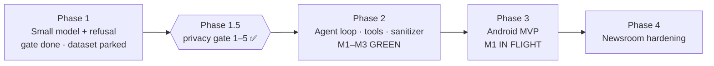

# Roadmap
> **Product niche (locked 2026-10-29 ~18:53 PDT):** pure local-first AI — private personal research agent; Android goal primary (app not shipped); web companion. See `docs/notes/PRODUCT_NICHE.md`.

**Current: Phase 3 — Android MVP · pure local-first AI · M1 IN FLIGHT** · Phase 2 M1–M3 GREEN · Phase 1 gate done · dataset PARKED · Phase 1.5 (1)–(5) SIGNED · Niche locked pure AI (Product+Lead ~18:53 PDT)

## Phase 1 — Small model that refuses to leak
- [x] Model choice (Qwen2.5-7B-Instruct; Llama-3.1-8B alt) — configs/model_config.yaml
- [x] Seed dataset builder + 40+ seed examples, 10+ eval prompts
- [x] QLoRA fine-tune script, eval harness, local inference CLI
- [ ] Expand dataset to 2–5k curated examples — **PARKED**; on unpark = **privacy AI** (privacy / refusal / safe personal AI → journalism sources/PII/secrets) (Lead pivot: privacy AI, not domain-SLM). Seed 362. See `docs/notes/SLM_PIVOT_PRIVACY_FIRST.md`
- [ ] First adapter trained + baseline vs. tuned eval report (0.5B CPU report landed 18:20 PDT, no gain; 7B GPU run pending)
- [ ] GGUF/llama.cpp quantized export for local use — **landed:** pin (`salomon-qwen25-7b-instruct-Q4_K_M.gguf`, bartowski single-file) + fetch/run scripts (`docs/notes/PHASE3_M1_LOCAL_GGUF.md`). **Weights fetched + lock-verified (7B + 3B mobile); Runtime live smoke PASS 5/5 both, offline via netns (2026-10-29 ~18:15 PDT, `phase3-runtime/EVIDENCE_PHASE3_M1_LIVE_GGUF.md`).** Not landed: own-adapter export.

## Phase 1.5 — Privacy merge gate (Lead decision, Oct 28 2026)
> Reframed 2026-10-29: this is a privacy merge gate for local-first + optional verified remote compute, not a product dependency on any specific cloud provider. Sign-offs below are unchanged.
Opens after Phase 1 is complete. Stub/criteria items **(1)–(5) SIGNED OFF**. R3 near-echo **CLEARED**. Item **(6) APPROVED** — `z-ai/glm-5.3-flash` allowlist now **two** entries (`19aea169…` via `docs/signoffs/SECURITY_SIGNOFF_PRE_PHASE2_ITEM6_GLM.md`; `7bb9af0a…` via `docs/signoffs/SECURITY_SIGNOFF_PHASE2_SECOND_INSTANCE_GLM.md`, effective_from 2026-10-29T17:10:00Z; Abliterated DeepSeek/Qwen rejected). Phase 2 **M1–M3 GREEN** (multi-step live PASS; M3 evidence on file (signoffs / phase2)) + dual-instance live + sanitizer TS. Unknown instances DENY+retry. Soft polish **CLOSED**: formal GLM refusal stamp 8/8 (`docs/signoffs/SECURITY_SIGNOFF_GLM_LIVE_REFUSAL.md`); `compose_file_sha256` **MERGE APPROVED** (`docs/signoffs/SECURITY_SIGNOFF_COMPOSE_FILE_SHA256_MIGRATION.md`); `role:tool` sanitizer PS-accepted. M3 skim OK (`docs/archive/near/SECURITY_REVIEW_PHASE2_M3.md`).
- [x] (1) Threat model doc — SIGNED OFF (docs/threat-models/THREAT_MODEL_PHASE1.5.md filled, Oct 29 2026). See docs/signoffs/SECURITY_SIGNOFF_PHASE1.5_1_3_4.md
- [x] (2) Attestation verify client, fail-closed — SIGNED OFF Privacy Security (phase1.5-attestation/ 15/15, Oct 29 2026). Bar: docs/acceptance/ATTESTATION_ACCEPTANCE.md. Evidence: docs/signoffs/SECURITY_SIGNOFF_ATTESTATION_ITEM2.md. (a) R3 CLEARED; item (6) GLM allowlist APPROVED; Phase 2 **M1 GREEN** + **M2 landed**; provider_tee binding demonstrated on M1 happy path.
- [x] (3) Sanitizer stub + unit tests — SIGNED OFF (privacy/sanitizer.py 17/17, Oct 29 2026). Phase 2: TS parity port in-loop (`phase2/SANITIZER.md`; 17-vector parity). See docs/signoffs/SECURITY_SIGNOFF_PHASE1.5_1_3_4.md
- [x] (4) Policy/spend stub — SIGNED OFF Privacy Security (criteria + privacy/policy_spend.py 11/11, Oct 29 2026). Residuals: non-durable counters (not for real funds); 64-hex ambiguity; human-approval daily total. See docs/signoffs/SECURITY_SIGNOFF_PHASE1.5_1_3_4.md
- [x] (5) Refusal / must-not-echo eval suite that fails CI — SIGNED OFF by Privacy Security (7B Colab 8/8 anti-echo). Artifacts: phase1-slm/outputs/eval_refusal_7b_anti_echo/, docs/signoffs/SECURITY_SIGNOFF_REFUSAL_7B.md. R3 near-echo pre-Phase-2 delta **CLEARED** (`docs/signoffs/SECURITY_SIGNOFF_R3_NEARECHO_DELTA.md`; artifacts phase1-slm/outputs/eval_refusal_7b_r3_nearecho/ 8/8). Item (5) stays closed. Owner: SLM Engineer (harness updates)
- [x] (6) Production allowlist pin(s) — **APPROVED** Privacy Security for `z-ai/glm-5.3-flash`: entry 1 `19aea169…` (`docs/signoffs/SECURITY_SIGNOFF_PRE_PHASE2_ITEM6_GLM.md`, effective_from 2026-10-29T17:00:00Z); entry 2 `7bb9af0a…` **APPROVED + appended** (`docs/signoffs/SECURITY_SIGNOFF_PHASE2_SECOND_INSTANCE_GLM.md`, effective_from 2026-10-29T17:10:00Z). `measurements.json` has **two** entries. Abliterated DeepSeek/Qwen rejected. Unknown instances still DENY+retry. Soft: refusal suite on live GLM before refusal claims.

Owners: Privacy Security owns gate acceptance and reviews every Phase 2 PR touching tools, remote inference, or keys. Agent Engineer implements attestation verify. SLM Engineer owns refusal eval harness updates.

## Phase 2 — Agent loop, safe tools, sanitizer (M1–M3 GREEN)
> Reframed 2026-10-29: M4 (propose-only stubs) is kept as a **safe-tooling pattern**. G3 (execute/sign) was never opened and is not planned.
**Scope now:** agent loop + safe tools + sanitizer. **M1–M3 GREEN** + soft polish CLOSED. Verified-remote pattern kept (provider archived). **M4** propose-only pattern archived (G1+G2 ACCEPTED; salomon `79c0f99`); **G3 never opened**. Phase 1 gate done; dataset PARKED. Allowlist pins remain engineering history. **Phase 3 M1 is now the active product milestone.**
- [x] Tool schema + read-only allowlisted tools + multi-step chaining w/ hard caps (prior demo domain archived)
- [x] Agent loop (TS) with injection-safe tool output handling — **M2 landed** + skim OK; dual-instance live; TS sanitizer; **M3** multi-step chaining w/ hard caps
- [x] Verified-remote inference backend with fail-closed attestation check (archived provider; pattern kept) — **M1 GREEN**; two pins live-verified; unknown instances DENY+retry
- [x] **M3 GREEN** — more read-only tools + multi-step chaining w/ hard caps; UNTRUSTED+sanitizer; no writes/sign; GLM only (`EVIDENCE_PHASE2_M3_MULTI_TOOL.md`)
- [x] **M4 propose-only pattern** — G1+G2 ACCEPTED; G3 never opened; settlement target retired from product narrative
- [ ] **M4 G3** — execute/sign/simulate — **NOT opened**

## Phase 3 — Android local AI MVP
> Product niche locked (`docs/notes/PRODUCT_NICHE.md`). Success bar: no cloud-by-default · no secret echo · no silent exposure · source-ID masked before model (M2) · credentials outside model · plain refuse/mask reasons.
>
> **M0 DONE** — Scope lock: Phase 3 brief locked (Android local-AI MVP primary; pure-AI product lock ~18:55 PDT).
> **M1 IN FLIGHT** — Local run path: offline/local `ask` end-to-end (fail closed if model missing). **Primary surface = Next.js web app + API** (`POST /api/ask` → `askLocal`); **CLI secondary**. Runbook: `docs/notes/PHASE3_MVP_RUNBOOK.md`. Web stack: `docs/notes/PHASE3_WEB_STACK.md`.
>
> Later: **M2** ingest + source-identity masking · **M3** propose-only save/export + approval UX · **M4** dogfood cut. Dataset **PARKED**. Do not claim M2/M3 as shipped.
- [ ] **M1** Offline/local `ask` on Next.js + API (primary); CLI optional/secondary; fail closed if model missing — **live GGUF smoke PASS (runtime + `/api/ask`)**; GREEN pending PS soft-skim
- [ ] **M2** Local document ingest + source-identity masking before the model
- [ ] **M3** Propose-only save/export with explicit approval; credentials outside the model
- [ ] Untrusted-input handling for leaked documents, web pages and emails (injection-safe tool output — proven in Phase 2)
- [ ] Plain-language refuse/sanitize reasons in the UX
- [ ] GGUF / llama.cpp quantized export so the model runs on a reporter's laptop, offline — pin + scripts landed; weight fetch pending Lead/user OK; **not live until Runtime smoke green**
- [ ] **M4** Dogfood cut

## Phase 4 — Newsroom hardening
- [ ] Durable policy engine (allowlists, export rules, per-project isolation)
- [ ] Encrypted local project vaults; audit log that never records source identities
- [ ] Optional remote inference only on verified confidential compute (fail-closed verify client already exists)
- [ ] Threat model refresh for on-device / personal-agent adversaries (device seizure, subpoena, targeted phishing); deployment guides; open-source release

## Retired narrative tracks
Prior chain / domain-specific product tracks were removed from the live narrative (~18:53 PDT pure-AI lock). Evidence may remain under `docs/archive/` pending Lead delete OK — not product scope.

